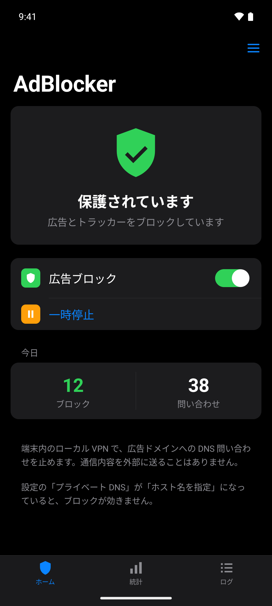
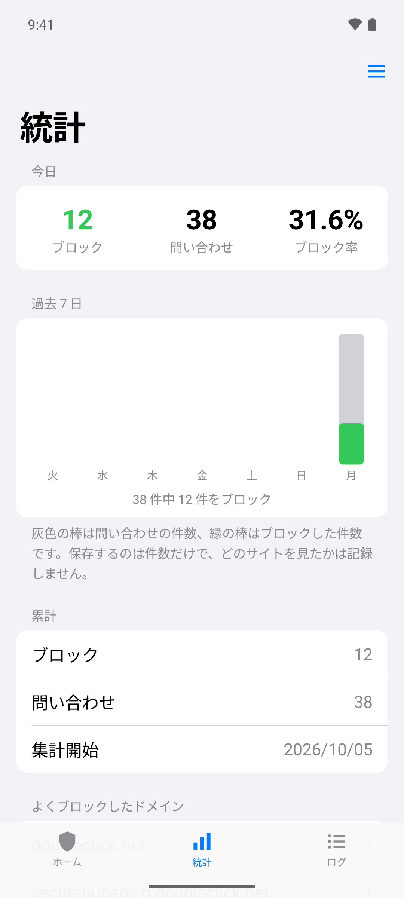
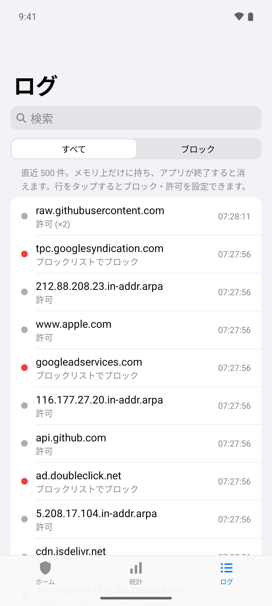

# AdBlocker

[English](README.md) | **日本語**

Android 用の広告ブロッカーです。端末の中だけで動く VPN を使い、広告やトラッカーのドメインへの DNS 問い合わせを遮断します。root は不要で、通信の中身を外部へ送ることはありません。

> **このリポジトリのコード・ドキュメント・アイコンは、[Claude Code](https://claude.com/claude-code) (Anthropic の AI コーディングツール) が作成しました。**

<p>
  
  
  
</p>

**目次:** [ダウンロード](#ダウンロード) · [機能](#機能) · [制限事項](#制限事項) · [ブロックリスト](#ブロックリスト) · [ビルド](#ビルド) · [ファイル構成](#ファイル構成) · [ライセンス](#ライセンス)

## ダウンロード

[Releases](https://github.com/tonbo2339/AdBlocker/releases/latest) から `AdBlocker-vX.Y.apk` をダウンロードしてインストールしてください (「提供元不明のアプリ」のインストールを許可する必要があります)。
一度インストールすれば、その後はアプリが新しいバージョンを確認して自動でアップデートします。

- 対応 OS: Android 8.0 以上

## 機能

### ブロック

- **広告ブロック**: StevenBlack・AdGuard DNS filter・HaGeZi Pro の約 36 万ドメインへの接続を遮断します
- **CNAME による偽装の検出**: サイトのサブドメインに見せかけたトラッカーも、CNAME の転送先がブロック対象なら遮断します
- **DNS を自分で指定するアプリもブロック** (任意): 8.8.8.8 や 1.1.1.1 などの公開 DNS へ直接送られる問い合わせも判定します。これらのサーバーへの暗号化 DNS (DNS over HTTPS / TLS) は拒否し、端末の DNS を使わせます
- **プライベート DNS の警告**: 「プライベート DNS」が「ホスト名を指定」になっていてブロックが効かないときに知らせます

### 自分のルール

- **ブロックリストの選択**: 組み込みのリストをオン / オフできるほか、好きなリストを https の URL か、この端末のファイルで追加できます (ファイルは毎日の更新のときに読み直します)
- **ブロック・許可するドメイン**: ドメインを手動でブロック・許可できます。サブドメインにも適用され、許可が優先されます。ワイルドカード `*` (`ads.*`、`*tracker*` など) や、IP アドレス・範囲 (`203.0.113.0/24` など) も指定できます。IP アドレスを指定すると、そのアドレスに解決される名前をブロックします
- **ルールのテキスト入出力**: ルールを、テキストのファイル (1 行に 1 つ、許可は行頭に `@@`。hosts ファイルも読めます) で読み込み・書き出しできます
- **例外アプリ**: 選んだアプリは広告ブロックの対象外になり、通常どおり通信します (広告ブロックで動かなくなるアプリ向け)
- **ブロックしない Wi-Fi**: 指定した Wi-Fi (名前で指定) では広告をブロックしません。すでに広告を遮断している自宅の Wi-Fi などに使えます。アプリを閉じていても自動で切り替わります。Wi-Fi の名前を取得するために位置情報の許可 (「常に許可」) が必要ですが、位置情報そのものは使いません

### オン / オフの操作

- **一時停止**: VPN を切らずに、5 分・15 分・1 時間だけブロックを止めます。一時停止中は、通知に再開時刻と「再開」ボタンが表示されます
- **ホーム画面のウィジェット**: タップでオン / オフ、右のボタンで一時停止できます。盾だけの小さな大きさまで縮められます
- **クイック設定タイル**: 通知パネルからオン / オフを切り替えられます (一時停止中にタップすると再開します)
- **ランチャーのショートカット**: アプリのアイコンを長押しすると、「一時停止 / 再開」と「オン / オフ」を選べます
- **外部アプリからの操作** (任意、既定はオフ): Tasker や MacroDroid が、ブロードキャストでオン / オフや一時停止をできます。[外部アプリからの操作](#外部アプリからの操作)を参照してください
- 端末の再起動後やアプリのアップデート後に自動で再開します。常時接続 VPN にも対応しています

### DNS

- **高速な名前解決**: 応答を有効期限 (TTL) の間キャッシュします。DNS サーバーの応答が遅いときは別のサーバーにも並行して問い合わせ、失敗したときはアプリをタイムアウトまで待たせずにすぐ返します。応答が大きくて TCP に切り替わる問い合わせにも対応しています
- **暗号化 DNS** (任意): 問い合わせを DNS over TLS (853 番) か DNS over HTTPS (443 番。853 番を塞ぐ回線向け) で Cloudflare・Google・Quad9、または自分で指定したサーバー (名前か URL と IP アドレス) に送ります。選んだ方式がつながらないときは、同じ事業者のもう一方の方式を試します

### ログと統計

- **問い合わせのログ**: 直近 500 件の問い合わせについて、ブロックしたかどうか、応答にかかった時間、問い合わせたアプリ (Android 10 以上) を表示します。ドメイン名やアプリ名で検索でき、タップするとブロック・許可を設定できます。標準ではメモリ上にだけ保持しますが、1 日・7 日・30 日分を端末に保存し、CSV で書き出すこともできます (ログをオフにしたり期間を短くしたりするときは、保存済みのログを削除する前に確認します)。ログ自体をオフにもできます
- **ブロックの理由**: ログの行をタップする (または「ブロック・許可するドメイン」の「ドメインを調べる」) と、どのリストやルールが原因か分かります
- **統計**: 今日の件数、過去 7 日間のグラフ、累計、ブロック数の多いドメインとアプリ、リストごとのブロック数を表示します。応答時間 (平均・最も遅かったとき・キャッシュで答えた割合) も見られます。保存するのは件数だけで、閲覧したサイトは記録しません

### 更新・バックアップ・表示

- **ブロックリストの自動更新**: 1 日 1 回、最新のリストを取得します (時刻を指定できます)
- **アプリの自動アップデート**: 1 日 1 回 GitHub Releases を確認し、新しいバージョンがあれば自動でアップデートします (通知だけにすることもできます)
- **Wi-Fi のときだけ自動更新**: ブロックリストとアプリの自動更新をモバイル通信では行いません (標準でオン)
- **通知の設定**: アプリのアップデート、ブロックリストの更新、動作中の表示を、それぞれオン / オフできます
- **設定のバックアップ**: ブロック・許可したドメイン、例外アプリ、ブロックしない Wi-Fi、各種設定をファイルに書き出し、機種変更後の端末で読み込めます。Wi-Fi の名前も設定の一部なので、このファイルと、Android 自身のアプリ設定のクラウドバックアップにも含まれます。端末内のリストのファイルと、「外部アプリからの操作」のスイッチは含まれません
- ライトモード / ダークモード
- 日本語 / 英語 (端末の言語に従います。Android 13 以上では、アプリごとに言語を設定できます)

### 外部アプリからの操作

標準ではオフです。オンの間は、端末のどのアプリからも、パッケージ `io.github.tonbo2339.adblocker` 宛てに次のブロードキャストを送れます。使わないときはオフにしてください。

| アクション | 動作 |
|---|---|
| `io.github.tonbo2339.adblocker.action.START` | ブロックをオンにする |
| `io.github.tonbo2339.adblocker.action.STOP` | ブロックをオフにする |
| `io.github.tonbo2339.adblocker.action.PAUSE` | 一時停止する (追加情報 `minutes` で分を指定。既定は 15、最大 1440) |
| `io.github.tonbo2339.adblocker.action.RESUME` | 再開する |

バックグラウンドからの START は Android に断られることがあります。そのときは通知でアプリを開くよう知らせます。

## 制限事項

- Android では VPN を同時に 1 つしか使えません。ほかの VPN アプリを起動すると、AdBlocker は自動でオフになります
- 「プライベート DNS」が「ホスト名を指定」になっているとブロックが効きません (「自動」か「オフ」にしてください)。この場合はアプリが警告を表示します
- ドメイン単位で通信を遮断する仕組みのため、ページのレイアウトは変えられません。広告があった場所の空白や、読み込めなかった画像の「×」、「閉じる」ボタンなどが残ることがあります。これらも消したい場合は、ブラウザー内で動く広告ブロッカー (Firefox と uBlock Origin など) を併用してください
- コンテンツと同じドメインから配信される広告 (YouTube の動画広告など)、IP アドレスを直接指定した通信、主要な公開 DNS 以外へのアプリ独自の DNS over HTTPS は遮断できません
- 広告を遮断すると、代わりに自前の広告 (ストアのアフィリエイトバナーなど) を表示するサイトがあります。サイトやストアと同じサーバーから配信されるため、遮断するとサイトやストアそのものが使えなくなります
- 広告ブロックを検出するとページ全体を隠す (「広告を許可してください」と表示する) サイトがあります。この仕組みでよく使われるサービス (html-load.com / content-loader.com) は遮断しないようにしているため、ページは読めますが、広告の一部が表示されることがあります

## ブロックリスト

| 取得元 | ライセンス |
|---|---|
| [StevenBlack/hosts](https://github.com/StevenBlack/hosts) | MIT |
| [AdGuard DNS filter](https://github.com/AdguardTeam/AdGuardSDNSFilter) | GPL-3.0 |
| [HaGeZi Pro](https://github.com/hagezi/dns-blocklists) | GPL-3.0 |
| [HaGeZi Pro++](https://github.com/hagezi/dns-blocklists) (標準ではオフ) | GPL-3.0 |

- 「設定 → ブロックリスト」でオン / オフを切り替えられます。hosts・ドメイン一覧・`*.ドメイン`・Adblock 形式のリストを、https の URL か端末のファイルで追加することもできます。Adblock 形式のリストはドメインのルールだけを使い、ページの一部を隠すルール (`example.com##.ad` など) は無視します
- 1 日 1 回 (または画面の「今すぐ更新」で) 取得します。ETag を使い、変更がなければダウンロードしません
- リストは取得元ごとに保存し、取得に失敗した取得元は前回の内容を使い続けます。組み込みのリストは、ルールが 1,000 件未満なら異常とみなして使いません
- 例外ルール (`@@||domain^`) にも対応しています
- 最初のダウンロードが終わるまでは、アプリに同梱した StevenBlack のリスト (`app/src/main/assets/blocklist.txt`) を使います (StevenBlack がオンの場合のみ)

同梱リストを更新するには:

```
curl -sSL https://raw.githubusercontent.com/StevenBlack/hosts/master/hosts \
  | tr -d '\r' | awk '$1=="0.0.0.0" && $2!="0.0.0.0" {print tolower($2)}' | sort -u \
  > app/src/main/assets/blocklist.txt
```

## ビルド

Android Studio でこのフォルダーを開いて実行します。コマンドラインの場合:

```
gradlew assembleDebug          # app/build/outputs/apk/debug/app-debug.apk
gradlew assembleRelease        # app/build/outputs/apk/release/app-release.apk
gradlew testDebugUnitTest      # 単体テスト
gradlew lintDebug
```

### リリースと自動アップデート

アプリは `https://api.github.com/repos/tonbo2339/AdBlocker/releases/latest` を確認し、タグ (`v0.1` など) が自身の `versionName` より新しければ、添付された `.apk` をダウンロードしてインストールします。

1. `app/build.gradle.kts` の `versionCode` を増やし、`versionName` を新しいバージョンにする
2. ビルドし、タグ `v<versionName>` のリリースに APK を添付する

インストールの前に、パッケージ名が同じこと、バージョンが上がっていること、署名がインストール済みのアプリと一致することを確認します。
Android 12 以上では、2 回目以降のアップデートは確認なしでインストールされます (初回だけ確認画面が表示されます)。

## ファイル構成

ソースは `app/src/main/java/io/github/tonbo2339/adblocker/` にあります。

**DNS とブロック**

| ファイル | 内容 |
|---|---|
| `AdBlockVpnService.kt` | VPN 本体 (tun の読み書き、ブロックの判定、上流の DNS への転送) |
| `Packets.kt` / `Dns.kt` / `DnsCache.kt` | IPv4 / IPv6 パケットと DNS メッセージの解析・組み立て / 応答のキャッシュ |
| `Filter.kt` / `UserRules.kt` / `Pause.kt` | 問い合わせごとの判定 (一時停止・ブロックしない Wi-Fi・手動のブロック / 許可・ブロックリスト) |
| `BlockList.kt` / `DomainSet.kt` / `RuleParser.kt` / `RuleText.kt` | ブロックリストの読み込みと照合 (親ドメイン・例外ルールに対応) / hosts / ドメイン / Adblock 形式の 1 行の解析 / テキストのルール |
| `UpstreamDns.kt` / `TcpDns.kt` | 転送先の DNS の選択 (回線の DNS を優先し、公開 DNS は予備) / TCP での再問い合わせ |
| `EncryptedDnsClient.kt` / `EncryptedDnsResolver.kt` / `Doh.kt` / `CustomDns.kt` | 暗号化 DNS (DNS over TLS / HTTPS、方式の切り替え、自分で指定するサーバー) |
| `PrivateDnsMonitor.kt` | 「プライベート DNS」が「ホスト名を指定」になっているかの検出 |

**ブロックリストと更新**

| ファイル | 内容 |
|---|---|
| `BlockListUpdater.kt` / `BlockListWorker.kt` / `UpdateConstraints.kt` | ブロックリストのダウンロード (URL とファイル)、1 日 1 回の自動更新、その時刻と通信条件 |
| `AppUpdater.kt` / `AppUpdateWorker.kt` / `InstallResultReceiver.kt` | GitHub Releases からの自動アップデート |

**ログと統計**

| ファイル | 内容 |
|---|---|
| `QueryLog.kt` / `QueryLogFiles.kt` / `QueryOwners.kt` / `StatsStore.kt` | 問い合わせのログ (メモリ上) / ファイルへの保存 / 問い合わせたアプリの特定 / 日ごとの件数 |
| `ListBreakdown.kt` / `DomainActions.kt` | リストごとのブロック数 / ドメインのブロック・許可メニューと理由 |

**画面**

| ファイル | 内容 |
|---|---|
| `MainActivity.kt` / `LogAdapter.kt` | ホーム / 統計 / ログのタブ |
| `SettingsActivity.kt` / `SettingsPages.kt` / `SettingsBuilder.kt` | 設定画面 (トップ、DNS・ログ・アップデート・通知・バックアップの各ページ、共通部品) |
| `RulesActivity.kt` / `BlocklistsActivity.kt` / `AppListActivity.kt` / `WifiSettingsActivity.kt` | ブロック・許可するドメイン / ブロックリスト / 例外アプリ / ブロックしない Wi-Fi |
| `SettingsBackup.kt` | 設定の書き出しと読み込み |
| `CardLayout.kt` / `BarChartView.kt` | 角丸のカード / 過去 7 日間のグラフ |

**オン / オフの操作**

| ファイル | 内容 |
|---|---|
| `BlockingControl.kt` | オン / オフと一時停止 (以下のすべてが共通で使う) |
| `ShortcutActivity.kt` / `RemoteControlReceiver.kt` / `ResumeReceiver.kt` | ランチャーのショートカットとウィジェット / 外部アプリからのブロードキャスト / 通知の「再開」ボタン |
| `AdBlockTileService.kt` / `AdBlockWidget.kt` / `StatusSurfaces.kt` | クイック設定タイル / ホーム画面のウィジェット / 両方の更新 |
| `WifiNetworks.kt` / `BootReceiver.kt` | 接続中の Wi-Fi の名前の監視 / 再起動後・アップデート後の自動再開 |

**その他**

| ファイル | 内容 |
|---|---|
| `Notifications.kt` / `Prefs.kt` | 通知 / 設定の保存 |
| `DebugLog.kt` / `DeveloperSettingsActivity.kt` | 不具合調査用のデバッグログ (開発者モード: 「設定 → アップデート」でバージョンを 5 回タップ)。ドメイン名や Wi-Fi の名前は記録しません |

## ライセンス

[MIT License](LICENSE)。ブロックリストは、それぞれのライセンスに従います ([NOTICE](NOTICE) を参照)。
