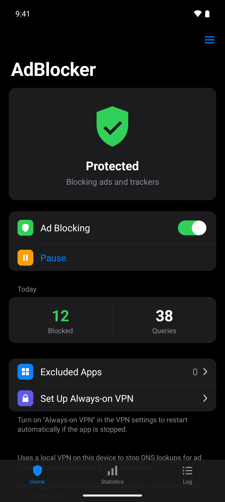
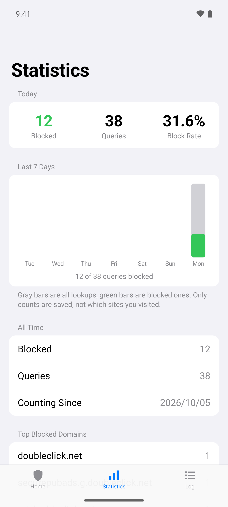
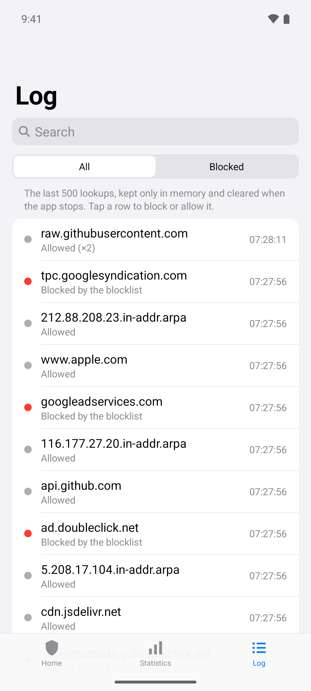

# AdBlocker

**English** | [日本語](README.ja.md)

An ad blocker for Android. It uses a VPN that runs only on the device to block DNS lookups for ad and tracker domains. No root is required, and the contents of your traffic are never sent anywhere.

> **The code, documentation and icon in this repository were made by [Claude Code](https://claude.com/claude-code) (Anthropic's AI coding tool).**

<p>
  
  
  
</p>

**Contents:** [Download](#download) · [Features](#features) · [Limitations](#limitations) · [Blocklists](#blocklists) · [Building](#building) · [Project layout](#project-layout) · [License](#license)

## Download

Download `AdBlocker-vX.Y.apk` from [Releases](https://github.com/tonbo2339/AdBlocker/releases/latest) and install it (you need to allow installing apps from unknown sources).
Once installed, the app checks for new versions and updates itself.

- Requires Android 8.0 or later

## Features

### Blocking

- **Ad blocking**: Blocks connections to about 360,000 domains from StevenBlack, AdGuard DNS filter and HaGeZi Pro.
- **CNAME cloaking detection**: Also blocks trackers disguised as a site's own subdomain, when the CNAME target is on the blocklist.
- **Block Apps' Own DNS** (optional): Also filters lookups sent straight to public DNS servers such as 8.8.8.8 or 1.1.1.1. Encrypted DNS (DNS over HTTPS / TLS) to these servers is refused, so apps fall back to the phone's DNS.
- **Private DNS warning**: Tells you when "Private DNS" is set to a hostname, which stops blocking from working.

### Your own rules

- **Choose blocklists**: Turn the built-in lists on or off, or add your own by https URL or from a file on the phone (read again with the daily update).
- **Block & Allow Domains**: Block or allow domains yourself. A rule also covers subdomains, and allow rules win. You can use the wildcard `*` (such as `ads.*` or `*tracker*`) and IP addresses or ranges (such as `203.0.113.0/24`). An IP address blocks any name that resolves to it.
- **Rules as text**: Import or export your rules as a plain text file (one rule per line, `@@` for allow; hosts files can be read too).
- **Excluded Apps**: Chosen apps bypass ad blocking and connect as usual (for apps that break with ad blocking).
- **Wi-Fi Without Blocking**: Ads are not blocked on Wi-Fi networks you choose by name, such as a home network that already blocks ads. Switches automatically, even while the app is closed. Reading the Wi-Fi name requires location access ("Allow all the time"), but your location itself is never used.

### Turning it on and off

- **Pause**: Stops blocking for 5 minutes, 15 minutes or 1 hour without turning the VPN off. While paused, the notification shows when blocking resumes and has a Resume button.
- **Home screen widget**: Tap it to turn blocking on or off, or use its pause button. It can be resized down to a single shield.
- **Quick Settings tile**: Turn blocking on or off from the notification shade (tap it while paused to resume).
- **Launcher shortcuts**: Long-press the app icon for "Pause / Resume" and "On / Off".
- **Control from other apps** (optional, off by default): Tasker or MacroDroid can turn blocking on or off or pause it with a broadcast. See [Control from other apps](#control-from-other-apps).
- Resumes automatically after a reboot or an app update, and works with Always-on VPN.

### DNS

- **Fast lookups**: Answers are cached for their TTL. When a DNS server is slow, other servers are asked in parallel, and a failure is reported right away instead of making apps wait for a timeout. Large answers that switch to TCP are handled too.
- **Encrypted DNS** (optional): Sends lookups to Cloudflare, Google, Quad9 or a server of your own (name or URL plus its IP address) over DNS over TLS (port 853) or DNS over HTTPS (port 443, for networks that block 853). If the method you choose can't connect, the other one is tried with the same provider.

### Log and statistics

- **Query log**: Shows the last 500 lookups, whether each was blocked, how long it took, and which app made it (Android 10+). Search by domain or app name, and tap a lookup to block or allow it. By default the log is kept only in memory, but you can also keep 1, 7 or 30 days on the phone and export it as CSV (the app asks before deleting a saved log when you turn the log off or shorten the period). The log itself can be turned off.
- **Why is it blocked?**: Tap a row in the log (or use "Check a Domain" in Block & Allow Domains) to see which list or rule is responsible.
- **Statistics**: Shows today's counts, a 7-day chart, all-time totals, the most-blocked domains and apps, and how many blocks each list covers. Response times (average, slowest, share answered from the cache) are shown too. Only counts are saved, not which sites you visited.

### Updates, backup and appearance

- **Automatic blocklist updates**: Fetches the latest lists once a day (you can choose the time).
- **Automatic app updates**: Checks GitHub Releases once a day and installs new versions automatically (you can choose to only be notified).
- **Update on Wi-Fi Only**: Automatic updates of blocklists and the app don't run on mobile data (on by default).
- **Notification settings**: App updates, blocklist updates and the running indicator can each be turned on or off.
- **Settings backup**: Exports your blocked and allowed domains, excluded apps, Wi-Fi networks without blocking and other settings to a file, which you can import on a new phone. Wi-Fi names are part of these settings, so they are also in the file and in Android's own cloud backup of the app's settings. Blocklist files on the phone and the "Control from other apps" switch are not included.
- Light mode / dark mode
- English / Japanese (follows the device language; on Android 13 and later you can set a language per app)

### Control from other apps

Off by default. While it is on, any app on the phone can send these broadcasts to the package `io.github.tonbo2339.adblocker`, so leave it off unless you use it.

| Action | Effect |
|---|---|
| `io.github.tonbo2339.adblocker.action.START` | Turn blocking on |
| `io.github.tonbo2339.adblocker.action.STOP` | Turn blocking off |
| `io.github.tonbo2339.adblocker.action.PAUSE` | Pause (extra `minutes`, default 15, at most 1440) |
| `io.github.tonbo2339.adblocker.action.RESUME` | Resume |

Android may refuse START from the background. In that case a notification asks you to open the app.

## Limitations

- Android allows only one VPN at a time. Starting another VPN app turns AdBlocker off.
- Blocking doesn't work while "Private DNS" is set to a hostname (set it to "Automatic" or "Off"). The app shows a warning when this happens.
- Blocking works on domain names, so it can't change page layouts. The blank space where an ad was, a broken-image icon (×) or a "close" button may remain. To remove those as well, also use an ad blocker that runs inside the browser (such as Firefox with uBlock Origin).
- Ads served from the same domain as the content (such as YouTube video ads), connections to hard-coded IP addresses, and apps' own DNS over HTTPS to servers other than the major public DNS can't be blocked.
- Some sites show their own ads (such as store affiliate banners) when other ads are blocked. These come from the same servers as the site or the store, so blocking them would break the site or the store itself.
- Some sites hide the whole page when they detect ad blocking ("please allow ads"). The service most often used for this (html-load.com / content-loader.com) is never blocked, so the page stays readable, but some ads may appear.

## Blocklists

| Source | License |
|---|---|
| [StevenBlack/hosts](https://github.com/StevenBlack/hosts) | MIT |
| [AdGuard DNS filter](https://github.com/AdguardTeam/AdGuardSDNSFilter) | GPL-3.0 |
| [HaGeZi Pro](https://github.com/hagezi/dns-blocklists) | GPL-3.0 |
| [HaGeZi Pro++](https://github.com/hagezi/dns-blocklists) (off by default) | GPL-3.0 |

- Lists can be turned on or off in "Settings → Blocklists". You can also add a list in hosts, domain, `*.domain` or Adblock format by its https URL, or from a file on the phone. From Adblock-format lists only the domain rules are used; rules that hide parts of a page (such as `example.com##.ad`) are ignored.
- Lists are fetched once a day (or with "Update Now" in the app). Nothing is downloaded if the ETag hasn't changed.
- Each source is stored separately, and if a source can't be fetched, its previous copy keeps being used. A built-in list with fewer than 1,000 rules is treated as broken and isn't used.
- Allow rules (`@@||domain^`) are supported.
- Until the first download finishes, the StevenBlack list bundled with the app (`app/src/main/assets/blocklist.txt`) is used (only while StevenBlack is turned on).

To update the bundled list:

```
curl -sSL https://raw.githubusercontent.com/StevenBlack/hosts/master/hosts \
  | tr -d '\r' | awk '$1=="0.0.0.0" && $2!="0.0.0.0" {print tolower($2)}' | sort -u \
  > app/src/main/assets/blocklist.txt
```

## Building

Open this folder in Android Studio and run it. From the command line:

```
gradlew assembleDebug          # app/build/outputs/apk/debug/app-debug.apk
gradlew assembleRelease        # app/build/outputs/apk/release/app-release.apk
gradlew testDebugUnitTest      # unit tests
gradlew lintDebug
```

### Releases and automatic updates

The app checks `https://api.github.com/repos/tonbo2339/AdBlocker/releases/latest`, and if the tag (such as `v0.1`) is newer than its own `versionName`, it downloads and installs the attached `.apk`.

1. Increase `versionCode` and set `versionName` to the new version in `app/build.gradle.kts`
2. Build, and attach the APK to a release tagged `v<versionName>`

Before installing, the app checks that the package name is the same, that the version is higher, and that the signature matches the installed app.
On Android 12 and later, updates after the first one install without asking (only the first one shows a confirmation).

## Project layout

Source files are in `app/src/main/java/io/github/tonbo2339/adblocker/`.

**DNS and blocking**

| File | Contents |
|---|---|
| `AdBlockVpnService.kt` | The VPN itself (reading / writing the tun, deciding what to block, forwarding to upstream DNS) |
| `Packets.kt` / `Dns.kt` / `DnsCache.kt` | Parsing and building IPv4 / IPv6 packets and DNS messages / caching answers |
| `Filter.kt` / `UserRules.kt` / `Pause.kt` | Deciding each lookup (pause, Wi-Fi without blocking, your blocked / allowed domains, blocklist) |
| `BlockList.kt` / `DomainSet.kt` / `RuleParser.kt` / `RuleText.kt` | Loading and matching the blocklist (parent domains and allow rules) / parsing one line in hosts / domain / Adblock format / rules as text |
| `UpstreamDns.kt` / `TcpDns.kt` | Choosing upstream DNS servers (the network's DNS first, public DNS as backup) / retrying over TCP |
| `EncryptedDnsClient.kt` / `EncryptedDnsResolver.kt` / `Doh.kt` / `CustomDns.kt` | Encrypted DNS (DNS over TLS / HTTPS, failover between them, your own server) |
| `PrivateDnsMonitor.kt` | Detecting "Private DNS" set to a hostname |

**Blocklists and updates**

| File | Contents |
|---|---|
| `BlockListUpdater.kt` / `BlockListWorker.kt` / `UpdateConstraints.kt` | Downloading blocklists (URLs and files), the daily automatic update, and its time and network conditions |
| `AppUpdater.kt` / `AppUpdateWorker.kt` / `InstallResultReceiver.kt` | Automatic updates from GitHub Releases |

**Log and statistics**

| File | Contents |
|---|---|
| `QueryLog.kt` / `QueryLogFiles.kt` / `QueryOwners.kt` / `StatsStore.kt` | Query log (in memory) / saving it to files / finding which app made a lookup / daily counts |
| `ListBreakdown.kt` / `DomainActions.kt` | Blocks per list / the block / allow menu and the reason for a domain |

**Screens**

| File | Contents |
|---|---|
| `MainActivity.kt` / `LogAdapter.kt` | Home / Statistics / Log tabs |
| `SettingsActivity.kt` / `SettingsPages.kt` / `SettingsBuilder.kt` | Settings (top page, the DNS / Log / Updates / Notifications / Backup pages, and shared parts) |
| `RulesActivity.kt` / `BlocklistsActivity.kt` / `AppListActivity.kt` / `WifiSettingsActivity.kt` | Block & Allow Domains / Blocklists / Excluded Apps / Wi-Fi without blocking |
| `SettingsBackup.kt` | Exporting and importing settings |
| `CardLayout.kt` / `BarChartView.kt` | Rounded cards / the 7-day chart |

**Turning it on and off**

| File | Contents |
|---|---|
| `BlockingControl.kt` | On / off and pause, shared by everything below |
| `ShortcutActivity.kt` / `RemoteControlReceiver.kt` / `ResumeReceiver.kt` | Launcher shortcuts and widget / broadcasts from other apps / the Resume button in the notification |
| `AdBlockTileService.kt` / `AdBlockWidget.kt` / `StatusSurfaces.kt` | Quick Settings tile / home screen widget / updating both |
| `WifiNetworks.kt` / `BootReceiver.kt` | Watching the connected Wi-Fi name / resuming after a reboot or an app update |

**Other**

| File | Contents |
|---|---|
| `Notifications.kt` / `Prefs.kt` | Notifications / saved settings |
| `DebugLog.kt` / `DeveloperSettingsActivity.kt` | Debug log for troubleshooting (developer mode: tap the version 5 times in "Settings → Updates"). Domain names and Wi-Fi names are not recorded |

## License

[MIT License](LICENSE). Each blocklist follows its own license (see [NOTICE](NOTICE)).
